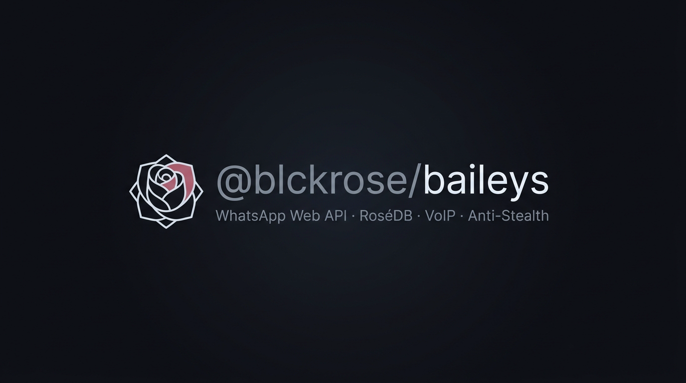

<p align="center">
  
</p>

<h1 align="center">@blckrose/baileys</h1>

<p align="center">
  <b>Production-ready, feature-packed WhatsApp Web WebSockets API for Node.js & Bun.</b><br />
  Built on modern Baileys v7 architecture with RoséDB auto-compaction, VoIP WebRTC calling, Anti-Stealth defense, transparent LID resolution, Newsletter auto-follow, and rich interactive builders.
</p>

<p align="center">
  <a href="https://www.npmjs.com/package/@blckrose/baileys"></a>
  = 20" />
  
  
  
</p>

---

## 🚀 Key Features

- ⚡ **Auto-Compaction RoséDB Auth State**: Ultra-fast AES-256-GCM encrypted session storage with automatic WAL checkpointing, pre-key pruning, and index slot repair to prevent disk bloat (keeps sessions ~1-2 MB).
- 📢 **Full Newsletter / Channels Support**: Create, manage, subscribe, react, and post media/PTVs. Built-in `autoFollowChannel` automatically joins specified channels upon connecting.
- 📹 **Video Note (PTV) Support**: Native support for circular WhatsApp Video Notes (`ptv: true`) across direct chats, groups, and broadcast channels.
- 📞 **VoIP Voice Calling (WASM + WebRTC)**: Outbound 1:1 WhatsApp voice calling with automated audio streaming (MP3, WAV, PCM buffers) powered by WebRTC.
- 🛡️ **Anti-Stealth Protection**: Built-in `sock.stealth` engine detecting invisible sender-key spam attacks with configurable sensitivity, grace windows, and circuit breakers.
- 🔄 **Transparent LID → Phone Resolution**: Seamlessly decodes and handles `@lid` addresses back to standard phone number JIDs (`@s.whatsapp.net`).
- 🎨 **Rich Message & Interactive Builders**: Easy-to-use helpers for Albums, Buttons, Carousels, Cards, Polls, Payment requests, and Status updates.
- 👥 **Multi-Session Engine**: Run and orchestrate hundreds of independent WhatsApp sessions concurrently on a single server.

---

## 📦 Installation

```bash
# npm
npm install @blckrose/baileys

# yarn
yarn add @blckrose/baileys

# pnpm
pnpm add @blckrose/baileys

# bun
bun add @blckrose/baileys
```

*Tip: You can also alias `@blckrose/baileys` as `baileys`:*
```bash
npm install baileys@npm:@blckrose/baileys
```

---

## ⚡ Quick Start & Authentication

### 1. Pairing Code Authentication (Phone Number)

```javascript
import makeWASocket, { useMultiFileAuthState, Browsers, DisconnectReason } from '@blckrose/baileys'

async function connectToWhatsApp() {
  const { state, saveCreds } = await useMultiFileAuthState('./sessions')

  const sock = makeWASocket({
    auth: state,
    browser: Browsers.ubuntu('Chrome'),
    printQRInTerminal: false
  })

  // Pairing code request
  if (!sock.authState.creds.registered) {
    const phoneNumber = '6281234567890' // Format: CountryCode + Number (No + or spaces)
    const code = await sock.requestPairingCode(phoneNumber)
    console.log(`Your Pairing Code: ${code}`)
  }

  sock.ev.on('creds.update', saveCreds)

  sock.ev.on('connection.update', (update) => {
    const { connection, lastDisconnect } = update
    if (connection === 'close') {
      const shouldReconnect = lastDisconnect?.error?.output?.statusCode !== DisconnectReason.loggedOut
      console.log('Connection closed, reconnecting:', shouldReconnect)
      if (shouldReconnect) connectToWhatsApp()
    } else if (connection === 'open') {
      console.log('✅ Connected successfully to WhatsApp!')
    }
  })
}

connectToWhatsApp()
```

### 2. QR Code Authentication

```javascript
import makeWASocket, { useMultiFileAuthState, Browsers } from '@blckrose/baileys'

const { state, saveCreds } = await useMultiFileAuthState('./sessions')

const sock = makeWASocket({
  auth: state,
  browser: Browsers.macOS('Desktop'),
  printQRInTerminal: true
})

sock.ev.on('creds.update', saveCreds)
```

---

## 💾 Storage: RoséDB with Auto-Compaction

For high-traffic bots, disk storage can bloat due to thousands of Signal pre-keys. `@blckrose/baileys` includes `useRoseDBAuthState` featuring automated background vacuuming, index recovery, and pruning:

```javascript
import makeWASocket, { useRoseDBAuthState } from '@blckrose/baileys'

const { state, saveCreds } = await useRoseDBAuthState('./sessions', {
  compactThresholdBytes: 10 * 1024 * 1024, // Compact if database exceeds 10MB
  preKeyLimit: 100,                        // Retain 100 freshest Signal pre-keys
  checkpointIntervalOps: 50                // Checkpoint WAL every 50 writes
})

const sock = makeWASocket({
  auth: state
})

sock.ev.on('creds.update', saveCreds)
```

---

## 📢 Channels & Newsletters

### Auto-Follow Default Channel on Connect
`@blckrose/baileys` automatically follows your specified channel when connection opens:

```javascript
const sock = makeWASocket({
  auth: state,
  // By default, automatically follows your designated channel on connect:
  autoFollowChannel: '120363433405105703@newsletter'
})
```

### Manual Channel Management
```javascript
// Follow a Channel
await sock.newsletterFollow('120363433405105703@newsletter')

// Unfollow a Channel
await sock.newsletterUnfollow('120363433405105703@newsletter')

// Mute / Unmute
await sock.newsletterMute('120363433405105703@newsletter')
await sock.newsletterUnmute('120363433405105703@newsletter')

// Fetch Channel Metadata
const meta = await sock.newsletterMetadata('invite', 'AbCdEf12345')
console.log('Channel Name:', meta.name, 'Subscribers:', meta.subscribers)

// Send Media to Channel
await sock.sendMessage('120363433405105703@newsletter', {
  image: { url: 'https://example.com/banner.jpg' },
  caption: 'Hello Newsletter subscribers! 👋'
})

// Send Video Note (PTV) to Channel
await sock.sendMessage('120363433405105703@newsletter', {
  video: fs.readFileSync('./circle-video.mp4'),
  ptv: true
})
```

---

## 💬 Sending Messages

### Text, Mentions & Formatting
```javascript
const jid = '6281234567890@s.whatsapp.net'

// Basic text
await sock.sendMessage(jid, { text: 'Hello from *Baileys*!' })

// Mentions
await sock.sendMessage(jid, {
  text: 'Hello @6281234567890!',
  mentions: ['6281234567890@s.whatsapp.net']
})

// Quoted reply
await sock.sendMessage(jid, { text: 'This is a reply' }, { quoted: m })
```

### Media (Images, Videos, PTV, Audio & Documents)
```javascript
import fs from 'fs'

// Image with Caption
await sock.sendMessage(jid, {
  image: fs.readFileSync('./photo.jpg'),
  caption: 'Here is your photo!'
})

// Video
await sock.sendMessage(jid, {
  video: { url: 'https://example.com/video.mp4' },
  caption: 'Streamed video clip'
})

// WhatsApp Video Note (PTV / Circular Video)
await sock.sendMessage(jid, {
  video: fs.readFileSync('./short-video.mp4'),
  ptv: true
})

// Voice Note (PTT audio waveform)
await sock.sendMessage(jid, {
  audio: fs.readFileSync('./voice.mp3'),
  mimetype: 'audio/mp4',
  ptt: true
})

// Document
await sock.sendMessage(jid, {
  document: fs.readFileSync('./report.pdf'),
  mimetype: 'application/pdf',
  fileName: 'Monthly_Report.pdf'
})
```

### Reactions, Polls & Location
```javascript
// React with an emoji
await sock.sendMessage(jid, {
  react: { text: '🔥', key: m.key }
})

// Interactive Poll
await sock.sendMessage(jid, {
  poll: {
    name: 'Which framework do you prefer?',
    values: ['Node.js', 'Bun', 'Deno'],
    selectableCount: 1
  }
})

// Location Pin
await sock.sendMessage(jid, {
  location: {
    degreesLatitude: -6.2088,
    degreesLongitude: 106.8456,
    name: 'Jakarta Central'
  }
})
```

---

## 📩 Receiving & Processing Messages

```javascript
import { downloadMediaMessage } from '@blckrose/baileys'

sock.ev.on('messages.upsert', async ({ messages, type }) => {
  if (type !== 'notify') return

  for (const msg of messages) {
    if (!msg.message || msg.key.fromMe) continue

    const sender = msg.key.remoteJid
    const messageType = Object.keys(msg.message)[0]
    const text = msg.message?.conversation || msg.message?.[messageType]?.caption || msg.message?.[messageType]?.text || ''

    console.log(`[Message] From: ${sender} | Type: ${messageType} | Content: ${text}`)

    // Auto-reply to ping
    if (text.toLowerCase() === 'ping') {
      await sock.sendMessage(sender, { text: 'Pong! 🏓' }, { quoted: msg })
    }

    // Downloading Media Attachments
    if (messageType === 'imageMessage' || messageType === 'videoMessage') {
      const buffer = await downloadMediaMessage(
        msg,
        'buffer',
        {},
        {
          logger: sock.logger,
          reuploadRequest: sock.updateMediaMessage
        }
      )
      console.log(`Downloaded ${messageType} size: ${buffer.length} bytes`)
    }
  }
})
```

---

## 📞 VoIP Voice Calling (WASM + WebRTC)

Make outbound 1:1 voice calls directly to WhatsApp contacts with custom audio streams:

```javascript
// Start an automated call
const call = await sock.call('6281234567890', {
  audio: './audio/greeting.mp3', // Path, URL, or PCM Buffer
  durationMs: 45000              // Max duration
})

call.on('ringing', () => console.log('🔔 Phone is ringing...'))
call.on('connected', () => console.log('📞 Call connected and audio playing!'))
call.on('ended', (reason) => console.log('📴 Call ended. Reason:', reason))

// Manually terminate call if needed
setTimeout(() => {
  call.hangup()
}, 30000)
```

---

## 🛡️ Anti-Stealth Group Defense

Block malicious sender-key bursts designed to crash or overload group messaging:

```javascript
const groupJid = '120363000000000000@g.us'

// Modes: MODE_OFF (0), MODE_WARN (1), MODE_ON (2)
sock.stealth.setMode(groupJid, sock.stealth.MODE_ON)

// Listen to security alarms
sock.stealth.on('stealth:burst', ({ jid, sender, burstCount }) => {
  console.warn(`[DEFENSE] Detected stealth attack from ${sender} in ${jid} (${burstCount} packets)`)
  // Kick malicious participant or mute group:
  sock.groupParticipantsUpdate(jid, [sender], 'remove')
})
```

---

## 👥 Group Management

```javascript
const groupJid = '120363000000000000@g.us'

// Create a new group
const group = await sock.groupCreate('My Awesome Group', ['6281234567890@s.whatsapp.net'])
console.log('Group created with JID:', group.id)

// Fetch group metadata
const metadata = await sock.groupMetadata(groupJid)
console.log(`Group: ${metadata.subject} | Members: ${metadata.participants.length}`)

// Promote / Demote participants
await sock.groupParticipantsUpdate(groupJid, ['6281234567890@s.whatsapp.net'], 'promote')
await sock.groupParticipantsUpdate(groupJid, ['6281234567890@s.whatsapp.net'], 'demote')

// Add / Remove participants
await sock.groupParticipantsUpdate(groupJid, ['6281234567890@s.whatsapp.net'], 'remove')

// Update Group Settings
await sock.groupSettingUpdate(groupJid, 'announcement') // Only admins can send messages
await sock.groupSettingUpdate(groupJid, 'not_announcement') // All members can send messages

// Get Group Invite Link
const inviteCode = await sock.groupInviteCode(groupJid)
console.log('Invite link:', `https://chat.whatsapp.com/${inviteCode}`)
```

---

## ⚙️ Configuration Reference

| Option | Type | Default | Description |
| :--- | :--- | :--- | :--- |
| `auth` | `AuthenticationState` | **Required** | Auth state from `useMultiFileAuthState` or `useRoseDBAuthState`. |
| `browser` | `WABrowserDescription` | `Browsers.macOS('Chrome')` | Client identification displayed in WhatsApp Linked Devices. |
| `autoFollowChannel` | `string \| boolean` | `'120363433405105703@newsletter'` | Newsletter channel to automatically join on connect. |
| `printQRInTerminal` | `boolean` | `false` | Pretty-prints the QR code to terminal console. |
| `markOnlineOnConnect`| `boolean` | `true` | Sets account presence status to available upon connecting. |
| `syncFullHistory` | `boolean` | `true` | Downloads complete chat history on initial pairing. |
| `connectTimeoutMs` | `number` | `20000` | Connection handshake timeout in milliseconds. |
| `keepAliveIntervalMs`| `number` | `30000` | WebSocket ping-pong keep-alive interval. |
| `logger` | `ILogger` | `Pino Logger` | Custom logger instance for logging events. |

---

## ⚠️ Disclaimer

This project is an open-source reverse-engineering of the WhatsApp Web protocol. It is **not** officially affiliated with, authorized, maintained, or endorsed by WhatsApp, Meta, or any of its subsidiaries. Use responsibly and adhere to WhatsApp's Terms of Service.

---

## 📄 License

Published under the [MIT License](LICENSE).  
Maintained with ❤️ by **Blckrosé**.
